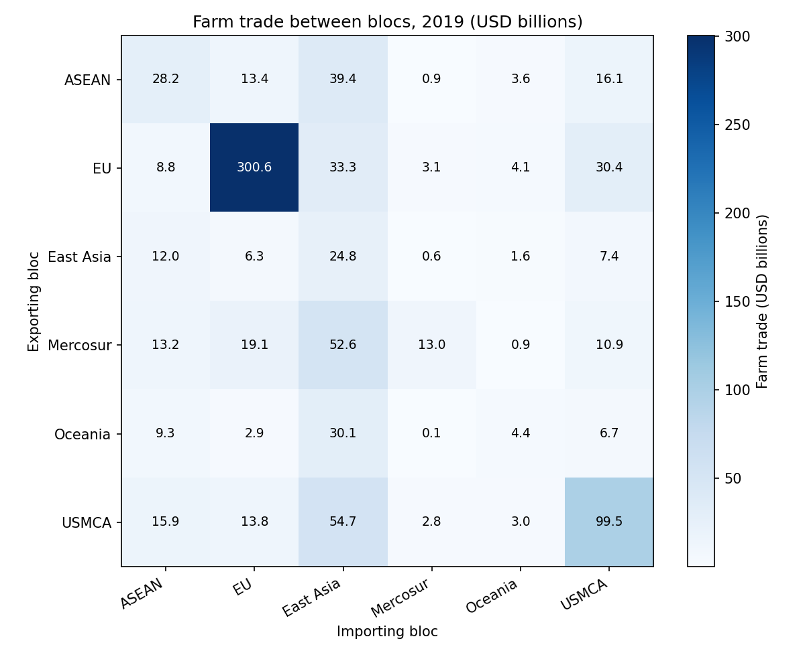

# Farm trade and farm support

An example project for the "AI for coding" course. You use it to learn how to explore and maintain a data project in three languages with an AI assistant.
It studies farm trade and farm support in 46 countries, grouped in 6 trade blocs, from 2000 to 2019.

## Purpose and why

- **Learning first.** The project is small but real: three languages, shared data, a Git history with branches, merges and fixes. It is a safe place to practise reading, running and changing code with AI.
- **Research questions,** one per language:
  - Python: who trades farm goods with whom?
  - R: how do distance, borders, language and trade agreements relate to farm trade?
  - Stata: how much of a farm subsidy reaches farm output, directly and through more fertiliser?

## Getting started

What you need:

- Python with `pandas` and `matplotlib`: `pip install pandas matplotlib`
- R with `fixest` (optional): `install.packages("fixest")`
- Stata 17 or later (optional)

How to run:

- Open this folder in Positron or VS Code.
- Run everything from the project root, the folder that holds this README.
- Python: `python code/00_master.py`
- R: `Rscript code/00_master.R`
- Stata: in Stata, `cd` to the project root, then `do code/00_master.do`
- Each master script runs its numbered scripts in order and writes to `outputs/`.
- The parts are independent: run one, two or all three.

All outputs are committed. If you do not have R or Stata, you can still see their results in `outputs/`.

## What's inside

Three languages answer three questions on one shared set of data:

- **Python, bloc charts:** adds up trade between blocs and draws a trend chart and a 2019 heatmap.
- **R, gravity model of trade:** a gravity model explains trade between two countries by their size and the distance between them. It is estimated by PPML, a regression method that keeps the zero trade flows. The results are associations, not causal effects.
- **Stata, subsidy pass-through:** a path model with Stata's `sem` command splits the effect of subsidy on output into a direct part and a part through fertiliser. A path model estimates linked equations together. **The data are synthetic.**

Each part writes a tidy file to `outputs/data/`. Their columns stay fixed, so they could feed one dashboard later:

- `bloc_trade.csv`: `year`, `bloc_from`, `bloc_to`, `trade_usd`
- `gravity_coefs.csv`: `term`, `estimate`, `std_error`, `p_value`
- `sem_effects.csv`: `effect`, `path`, `estimate`, `std_error`

## Data provenance

How the data move, step by step:

1. Download: FAOSTAT and CEPII publish the raw files.
2. `data/raw/`: the downloads are saved here. They are too large for Git, so only their description is kept.
3. `code/00_data_prep/`: one script filters, joins and cleans them, and makes the synthetic subsidy data.
4. `data/clean/`: the clean files, committed and ready to use.
5. `code/`: the analysis scripts read the clean files.
6. `outputs/`: figures, tables and tidy data, made by code only.

Sources and licences:

- Trade values: FAOSTAT Detailed Trade Matrix, FAO, bulk release of 2025-12-18. Licence: CC BY 4.0.
- Distance, border, language, trade agreements and GDP (the value of everything a country produces in a year): CEPII Gravity database, version V202211. Licence: Etalab Open Licence 2.0.
- Farm support: none. The data are made up.

**`farm_support.csv` is synthetic.** A computer program made the numbers from a known model. They are not real subsidies, fertiliser use or farm output for any country. An elasticity is the percent change in output when subsidy rises by 1 percent. The true elasticities are: direct 0.10, indirect through fertiliser 0.24, total 0.34. Use them to check the Stata results. Do not draw conclusions about real countries.

## Folder structure

- `data/raw/`: notes on the raw sources. Read-only. The raw files themselves are not in Git.
- `data/clean/`: clean data with a variable list. Made by code only; do not edit by hand.
- `code/`: numbered scripts and one master script per language. Data prep has its own folder, `code/00_data_prep/`. See `code/README.md`.
- `outputs/figures/`: charts. Made by code only.
- `outputs/tables/`: tables (text, CSV, Excel). Made by code only.
- `outputs/data/`: tidy data behind the results. Made by code only. Keep the columns fixed.
- `reports/`: notes and write-ups about the results. Flexible.

## Documentation

- [`code/README.md`](code/README.md): how to run all the code, stage by stage.
- [`code/00_data_prep/README.md`](code/00_data_prep/README.md): how the clean data are made.
- [`data/clean/README.md`](data/clean/README.md): every variable, its unit and its meaning.
- [`data/raw/README.md`](data/raw/README.md): sources, links, versions, licences and citations.
- [`AGENTS.md`](AGENTS.md): rules for AI assistants in this project.

## Who

- Team lead: README, data, merges.
- R analyst: gravity model.
- Stata analyst: subsidy pass-through.
- Python analyst: bloc charts.

The Git history records who changed what, when and why: ask your AI assistant to summarise it.

## News

Newest first. One entry per meaningful change or decision.

- 2026-06-16, Grace: The Stata master now stops with a clear message when it is not run from the project root. Why: the old error, "file not found" deep inside a do-file, did not say what to do.
- 2026-06-03, Amina: Wrote the rules for AI assistants in `AGENTS.md`. Why: new team members use assistants to find their way, and the assistant should explain before it changes anything.
- 2026-05-12, Grace: Stata part merged: the path model gets the true synthetic values back (direct 0.103, indirect 0.228, total 0.331).
- 2026-04-29, Mei: Python part merged: bloc trade totals, a trend chart and a 2019 heatmap.
- 2026-04-20, Tomas: R part merged: the PPML gravity model of farm trade, with its table and coefficient plot.
- 2026-04-06, Amina: Trade values converted from thousand USD to USD. Why: totals were 1,000 times too small.
- 2026-03-12, Amina: Work split by language: Python for the bloc charts, R for the gravity model, Stata for the subsidy path model. Why: each analyst works in the tool they know best, on their own branch.
- 2026-03-11, Amina: Added synthetic farm support data. Why: there are no comparable subsidy data for all 46 countries, and known true values let the Stata part test its model.
- 2026-03-09, Amina: Added the clean trade data and the script that makes them, `code/00_data_prep/prepare_data.py`. Clean data and outputs are now committed. Why: everyone works from the same data, and people without R or Stata still see every result.
- 2026-03-02, Amina: Started the project from the team template.

